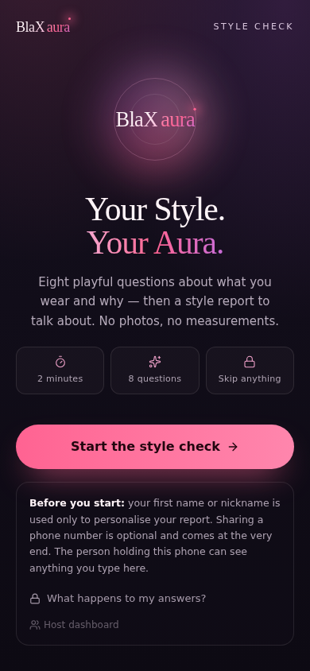
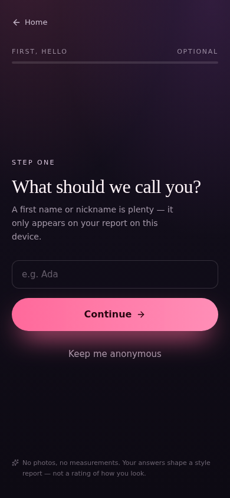
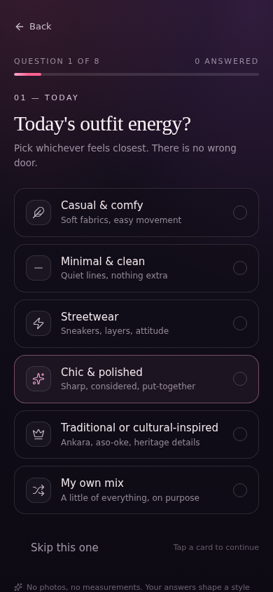
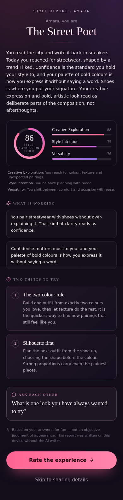
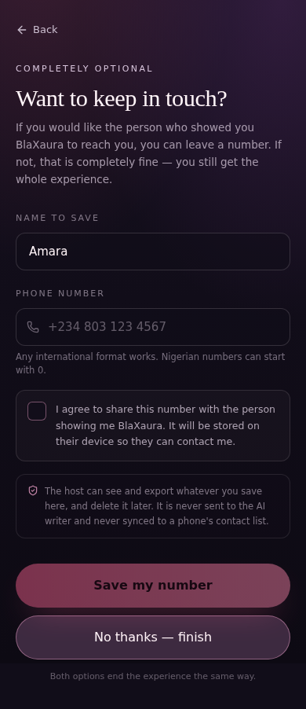
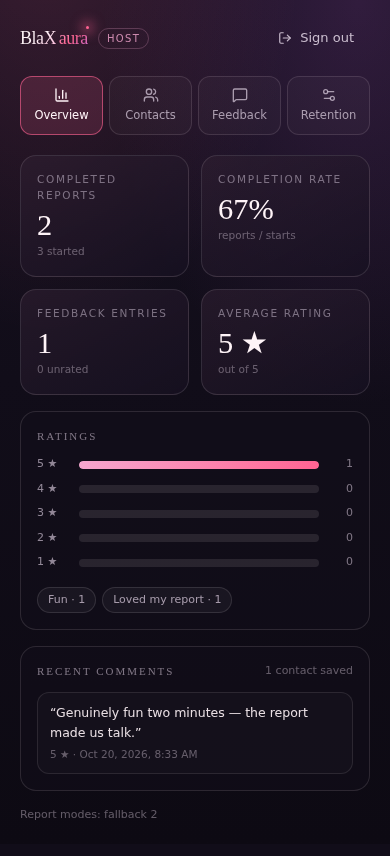

# BlaXaura — Your Style. Your Aura.

A mobile-first, locally hosted style-conversation experience. The host opens the site on their phone, hands it to someone they have just met, and the two of them go through eight playful questions in about two minutes. At the end the participant gets a **style report** bound to a style archetype, a playful *style-expression index*, two styling experiments and a conversation starter.

Everything below runs on one machine. No accounts, no cloud database, no analytics, no contact syncing.

---

## Quick start

```bash
npm install
cp .env.example .env          # optional: add GEMINI_API_KEY to enable AI-written copy
npm run dev                   # API on :8787, client on :5173
```

Open <http://localhost:5173>. The host dashboard lives at <http://localhost:5173/admin> — set a password the first time you open it (minimum 10 characters, hashed with Argon2id).

Without a Gemini key the app is fully functional: it writes the report with the deterministic engine in `packages/shared`. With a key, Gemini rewrites the *prose only*; the scores are still computed locally.

### Scripts

| Command | What it does |
| --- | --- |
| `npm run dev` | Runs the Fastify API (`tsx watch`) and the Vite client together |
| `npm run build` | Builds shared → server → web |
| `npm start` | Serves the built API, and the built client too when `SERVE_STATIC=true` |
| `npm run typecheck` | `tsc --noEmit` across every workspace |
| `npm run lint` | ESLint 9 flat config |
| `npm test` | Vitest: shared rules, server integration, client components |
| `npm run test:e2e` | Builds, then runs the Playwright suite against a throwaway database |
| `npm run test:all` | typecheck + lint + unit/integration + E2E |
| `npm run db:reset` | Deletes the local SQLite file (asks for confirmation; `--yes` to skip) |

### Single-port production run

```bash
npm run build
SERVE_STATIC=true PORT=8787 npm start   # http://localhost:8787 serves UI + API
```

---

## Configuration (`.env`)

| Variable | Default | Notes |
| --- | --- | --- |
| `GEMINI_API_KEY` | *(empty)* | Server-side only. Never exposed to the browser. |
| `GEMINI_MODEL` | `gemini-3.8-flash` | Must be a model ID the Gemini API actually serves. See `docs/library-research.md` for how this was verified. |
| `GEMINI_MODE` | `auto` | `off` forces the offline deterministic report (useful for demos and tests). |
| `GEMINI_TIMEOUT_MS` | `12000` | Per-request timeout, with one retry before falling back. |
| `DATABASE_PATH` | `./data/blaxaura.sqlite` | Directory is created automatically. |
| `PORT` | `8787` | API port; the Vite dev server proxies `/api` here. |
| `HOST` | `127.0.0.1` | `0.0.0.0` only for deliberate LAN use (see the warning below). |
| `SERVE_STATIC` | `false` (true in production) | Serve `apps/web/dist` from the API. |
| `ADMIN_PASSWORD` | *(empty)* | Optional first-run bootstrap. If empty, set the password in `/admin`. |
| `ADMIN_SESSION_HOURS` | `8` | Server-side session lifetime. |
| `COOKIE_SECURE` | `false` | Set to `true` when you put BlaXaura behind HTTPS. |

### Screens

| | | |
| --- | --- | --- |
|  |  |  |
| Welcome + privacy note | Optional name | One question per screen |
|  |  |  |
| Style report | Optional, consented contact | Host dashboard |

Captured from the running app at a 390 × 844 phone viewport (`docs/screenshots/`).

---

## What is in the box

```
BlaXaura/
├── apps/
│   ├── web/                  React 19 + TypeScript + Vite 7 + Tailwind 4
│   │   └── src/
│   │       ├── components/   Aurora, Wordmark, ScoreRing, ui/* (button, dialog, …)
│   │       ├── features/
│   │       │   ├── quiz/     Welcome, QuizFlow, OptionCard
│   │       │   ├── report/   Reveal (loading → report)
│   │       │   ├── feedback/ rating screen
│   │       │   ├── connect/  optional consented contact + thank-you
│   │       │   ├── admin/    host dashboard (lazy-loaded, auth-gated)
│   │       │   └── flow/     in-memory participant state
│   │       └── styles/       design tokens, aurora keyframes, reduced-motion rules
│   └── server/               Fastify 5 + better-sqlite3
│       └── src/
│           ├── routes/       public.ts, admin.ts
│           ├── services/     gemini.ts, report.ts, phone.ts
│           ├── auth/         argon2id hashing, server-side sessions, CSRF
│           ├── db/           migrations + open
│           └── lib/          sanitisation, redaction
├── packages/shared/          question bank, scoring rules, archetypes, fallback report, Zod schemas
├── e2e/                      Playwright specs (participant flow + accessibility)
├── docs/                     implementation plan, research notes, privacy & threat model
└── scripts/                  e2e server bootstrap, db reset
```

### Routes

| Route | Purpose |
| --- | --- |
| `/` | Animated welcome, privacy disclosure, start |
| `/quiz` | Name (optional) + one question per screen, Back / Skip, keyboard support |
| `/reveal` | Loading animation → report (never gated behind a phone number) |
| `/feedback` | 1–5 stars for *the experience*, tags, optional comment, retry intent, Skip |
| `/connect` | Optional phone with an **unchecked** consent box and a prominent "No thanks — finish" |
| `/done` | Thank-you; participant state wiped |
| `/admin` | Host-only: overview, contacts, feedback, retention |

---

## Style analysis: how the number is produced

The index is deliberately boring under the hood, because it must never look like a verdict on a person:

1. Each quiz option carries 0–10 weights for three dimensions — **Creative Exploration**, **Style Intention**, **Versatility** (`packages/shared/src/scoring.ts`).
2. A dimension score is `round(35 + 6.5 × mean(weights))`, clamped to 0–100. Skipped and "Prefer not to say" answers are excluded from the mean, so declining **never** lowers a score; with no answers every dimension sits at the neutral 35.
3. The style-expression index is `0.4×creative + 0.3×intention + 0.3×versatility` plus +1 per distinct signature choice (max +5), clamped to 0–100.
4. Every option — including no makeup, natural hair, protective styles, "keep it simple" and cultural dress — earns positive weights somewhere. The tests assert that bare skin is not scored as *less* intentional than a bold look.

Archetypes (`The Heritage Romantic`, `The Minimalist Spark`, `The Bold Curator`, `The Street Poet`, …) are picked by a transparent signal-matching function with a stable hash as a tie-breaker, so the same answers always give the same archetype.

### Gemini's role

- Input: the selected option labels only. **No name, no phone number, no feedback, no IP.**
- Output: `summary`, two `strengths`, two `experiments`, one `conversationStarter`, and an archetype title from a reviewed allow-list — requested through structured output (`responseMimeType: application/json` + `responseSchema`).
- The model is explicitly told it has not seen the person and must not comment on attractiveness, body, weight, skin colour, age or gender.
- Every string is sanitised (markup/control characters stripped, length capped, banned-phrase check). Schema violations, banned phrasing, timeouts, rate limits or any thrown error fall back to the deterministic report — the participant never sees a broken screen.

---

## Privacy and safety

- **Consent is real.** The checkbox starts unchecked, the client requires it to enable the button, and the server rejects anything that is not `consent: true`. The consent timestamp is written server-side; a client-supplied one is ignored.
- **Number optional, always.** Finishing without a number shows a complete, equally friendly thank-you screen.
- **No Android contacts.** Saved numbers live only in `data/blaxaura.sqlite`.
- **Host can see what participants submit** — the welcome screen says so plainly, because it is true.
- **Minimal storage.** Sessions store an id, timestamps and report mode — never quiz answers. Feedback never stores a phone number. Contacts never link to quiz responses.
- **Host dashboard** is protected by an Argon2id-hashed password, server-side sessions (only the SHA-256 of the session token is stored), `HttpOnly` + `SameSite=Strict` cookies, a double-submit CSRF header, origin checks on mutations, and login rate limiting.
- **Retention control** in the dashboard purges contacts/feedback older than a chosen window; individual rows and whole tables can be deleted, and contacts export to CSV with formula-injection guards.
- **Logs** redact cookies, CSRF tokens and phone numbers; a production build has no source maps and no secrets in the bundle.

Full notes: [`docs/privacy-and-security.md`](docs/privacy-and-security.md).

---

## Testing

```bash
npm test          # 55 server/shared + 12 client tests
npm run test:e2e  # 12 Playwright tests on a Pixel 7 profile
```

What is covered:

- **shared** — question-bank integrity, no appearance-judgment language, scoring determinism, skip/decline neutrality, archetype mapping, fallback report schema and grounding.
- **server** — report endpoint (fallback and Gemini modes), deterministic scores preserved over AI copy, malformed payloads, consent enforcement, phone normalisation (`0803…`, `+234…`, `+44…`), duplicate handling, feedback validation, admin auth (401s, rate limiting, CSRF, cross-origin rejection), stats aggregation, delete/clear/purge, CSV escaping, persistence across restart.
- **client** — quiz navigation/skip/anonymous path, conversation card, star rating toggling, API error mapping and report schema validation.
- **E2E** — full happy paths with and without a phone number, consent gating, Gemini-outage fallback, restart clears state, back/forward never resurrects a participant, 320 px layout, reduced motion, keyboard-only completion, unauthenticated dashboard access.

The E2E suite boots its own server on port 8799 with a disposable database, so your real `data/blaxaura.sqlite` is untouched.

---

## Using it on a phone (Fedora host)

BlaXaura on a laptop is a **website served from that laptop**, which is not the same thing as a server running on the Android device itself. The phone's browser is just a screen; the database lives on the computer.

Recommended: run it locally on the laptop and pass the laptop to the participant, or use the single-port build.

### Fedora, quick path

```bash
sudo dnf install nodejs npm git sqlite
git clone <your-repo> BlaXaura && cd BlaXaura
npm install
cp .env.example .env        # add GEMINI_API_KEY if you have one
npm run build
SERVE_STATIC=true npm start  # http://127.0.0.1:8787
```

### Opening it from another device on the same Wi-Fi (optional, deliberate)

1. In `.env` set `HOST=0.0.0.0`.
2. Allow the port through the firewall for your local network only:
   ```bash
   sudo firewall-cmd --add-port=8787/tcp --zone=home   # or --zone=FedoraWorkstation
   ```
3. Find your LAN address: `ip -4 addr show | grep inet` → browse to `http://192.168.x.x:8787` on the phone.

> **Warning — unencrypted traffic.** Plain HTTP on a LAN can be observed by anyone on that network, and anything typed (including a volunteered phone number) travels in the clear. Use this only on a network you trust, never on public or café Wi-Fi. For real-world use, put BlaXaura behind HTTPS (see below) or run it directly on the device that will hold the data. Do not expose the admin route or API to the public internet.

### HTTPS options

- Put the built app behind Caddy or nginx with a local certificate (`caddy reverse-proxy --from https://blaxaura.localhost --to 127.0.0.1:8787`), then set `COOKIE_SECURE=true` and `TRUST_PROXY=true`.
- Or run it as a PWA-style local app on the device and skip the LAN entirely.

### Fedora notes

- `better-sqlite3` builds against the system toolchain on `npm install`. If it fails: `sudo dnf install gcc-c++ make python3`.
- SELinux can block reading the database from unusual paths — keep it under the project directory, or check `sudo ausearch -m avc -ts recent`.

---

## Troubleshooting

| Symptom | Fix |
| --- | --- |
| "Could not reach the BlaXaura app on this device" | The API is not running. `npm run dev` starts both; otherwise run `npm run dev -w @blaxaura/server`. |
| Report says "written on this device without the AI writer" | No `GEMINI_API_KEY`, `GEMINI_MODE=off`, an unsupported `GEMINI_MODEL`, or a network/timeout error. The app is working as designed; check the server log for `gemini request failed`. |
| "That password did not match" on `/admin` | Six failed attempts in 10 minutes are throttled. Wait, or reset with `npm run db:reset` (this deletes saved contacts and feedback). |
| Forgot the host password | There is no recovery by design. `npm run db:reset` wipes the database; set a new password on next visit. |
| `EADDRINUSE` on 8787 / 5173 | Something else is using the port: `ss -ltnp \| grep 8787`. Change `PORT` (and the Vite proxy target) or stop the other process. |
| Phone on Wi-Fi cannot connect | Check `HOST=0.0.0.0`, the firewall rule above, and that both devices are on the same network. |
| Playwright cannot find a browser | `npx playwright install chromium`, or point `CHROMIUM_EXECUTABLE` at an existing Chrome/Chromium binary. |
| Empty dashboard after an event | Contacts appear only when someone ticked the consent box; feedback only when submitted. Both are optional by design. |

---

## Known limitations

- Reports are written in English only; the copy uses British spelling.
- Gemini may occasionally produce a response that fails sanitisation, in which case the deterministic report is shown instead (a few times per hundred in testing, and always safe).
- Rate limiting is per socket/IP. Behind a reverse proxy, set `TRUST_PROXY=true` so limits apply per client rather than to everyone at once.
- The LAN mode is HTTP-only; there is no built-in TLS.
- No photo upload, no measurements, no account system — by design, not by omission.
- Admin sessions are per browser; signing out invalidates them server-side.

## Next steps that would fit the design

Question packs per season, a PII-free shareable report image rendered on-device, host-adjustable quiz length and copy, an installable PWA shell with a low-data mode, and optional aggregate (never per-person) trend insights.
